<div align="center">

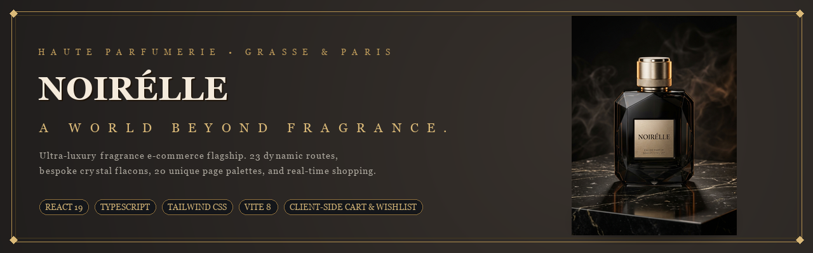

# NOIRÉLLE
### *A World Beyond Fragrance.*

[](https://react.dev/)
[](https://www.typescriptlang.org/)
[](https://vitejs.dev/)
[](https://tailwindcss.com/)
[](LICENSE)

<p align="center">
  <strong>An ultra-luxury international haute perfumery e-commerce platform.</strong><br>
  Built with React 19, TypeScript, Vite 8, Tailwind CSS, and React Router. Featuring 22 handcrafted bespoke flacons, 20 unique atmospheric background palettes, persistent client-side cart & wishlist state, and luxury WhatsApp concierge checkout.
</p>

[Explore Collections](#-the-five-realms-of-noirélle) • [Live Screenshots](#-visual-gallery--screenshots) • [Architecture](#-system-architecture) • [Getting Started](#-getting-started) • [Documentation](#-project-documentation)

---

</div>

## ✦ Brand Manifesto & Visual Identity

> *"In the quiet space between memory and emotion lies NOIRÉLLE — not merely a fragrance, but an indelible personal presence."*

NOIRÉLLE was conceived as an editorial digital flagship that mirrors the world's finest perfume houses. Moving beyond conventional e-commerce layouts, every collection and page introduces its own distinct mood, spatial rhythm, and atmospheric color palette while maintaining strict brand coherence.

### Atmospheric Color Matrix (20 Distinct Realms)

| Realm / View | Hex Code | Visual Tone & Contrast |
| :--- | :--- | :--- |
| **Homepage** | `#F5F0E8` | Champagne Ivory • Warm editorial contrast |
| **Shop All** | `#FAF9F6` | Pearl White • Minimalist studio showcase |
| **Men's Fragrances** | `#17191C` | Midnight Charcoal • Smoked obsidian & gold |
| **Women's Fragrances**| `#F3E8E5` | Dusty Rose • Warm Grasse May Rose ambience |
| **Unisex Fragrances** | `#E8EDE5` | Muted Sage • Contemporary botanical nuance |
| **Oud & Oriental** | `#211812` | Deep Espresso • Aged Cambodian agarwood & amber |
| **Luxury Extraits** | `#131418` | Royal Velvet Noir • 24k gold leaf illumination |
| **Gift Sets & Coffrets**| `#EDE1CE`| Champagne Beige • Handcrafted wood & silk |
| **Product Details** | `#F6F1E9` | Warm Ivory • High-focus tactile product study |
| **Shopping Cart** | `#EAE5DC` | Warm Stone • Structured, calm checkout path |
| **Wishlist** | `#EEECF2` | Pale Lavender • Intimate curation atmosphere |
| **Checkout Portal** | `#FBFAF7` | Clean Ivory • High-trust transactional elegance |
| **About Atelier** | `#151515` | Luxury Black • Haute craftsmanship storytelling |
| **Order Success** | `#EDF3EA` | Light Sage • Serene post-purchase celebration |

---

## ✦ Visual Gallery & Screenshots

Every screenshot below is captured directly from the live application runtime:

<div align="center">

### Desktop Experience

| 01 • Cinematic Homepage | 02 • Men's Midnight Collection |
| :---: | :---: |
| 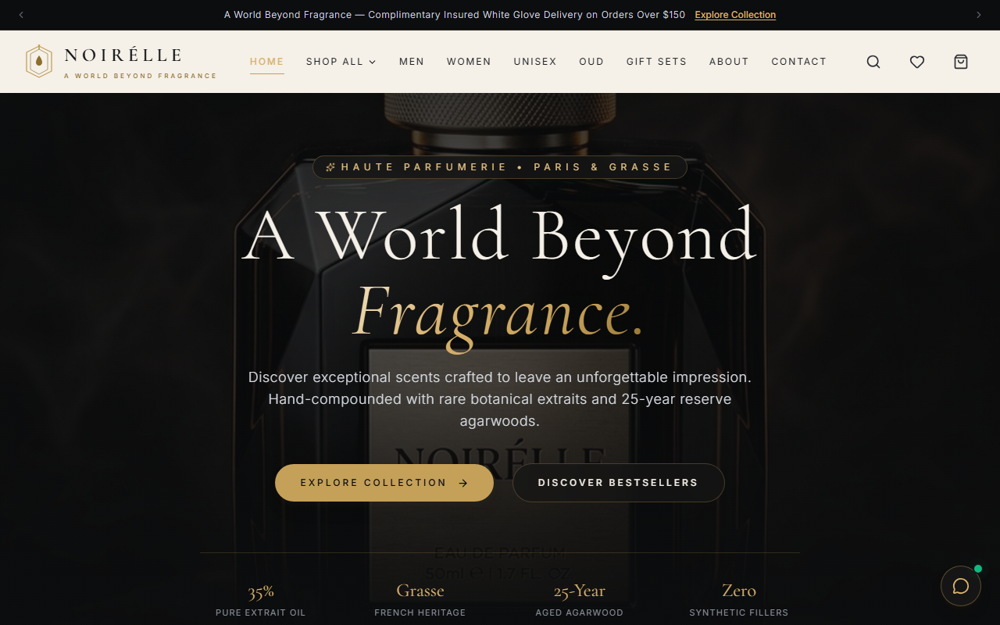 | 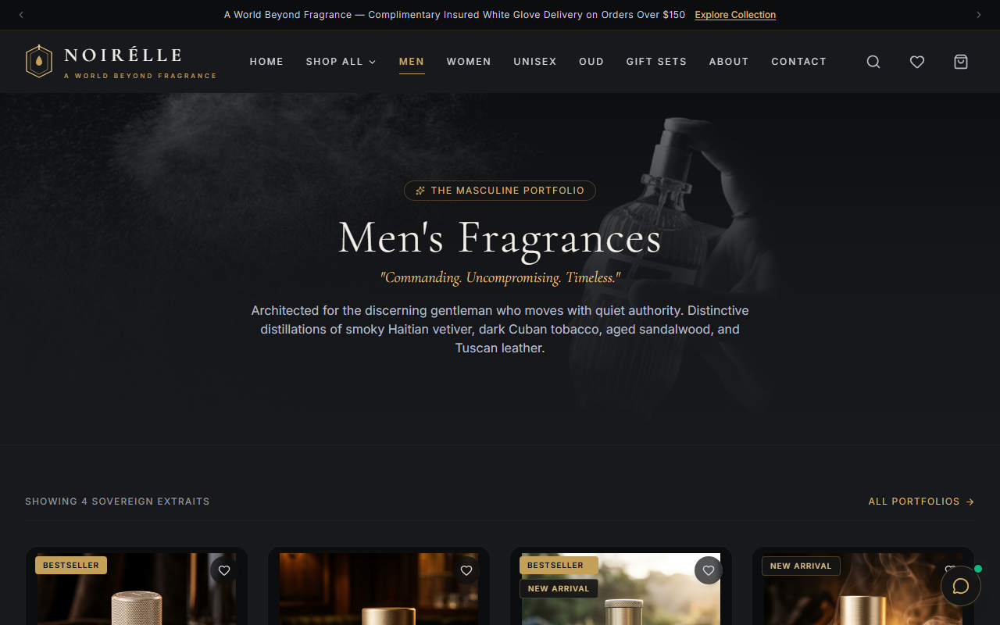 |

| 03 • Women's Floral Realm | 04 • Unisex Botanical Portfolio |
| :---: | :---: |
| 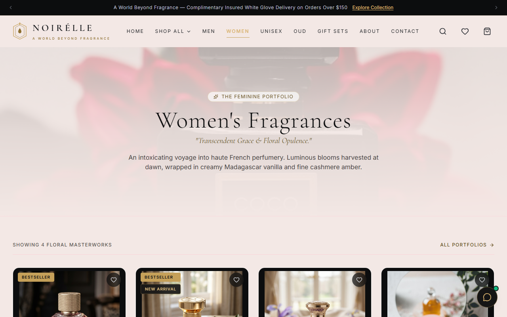 | 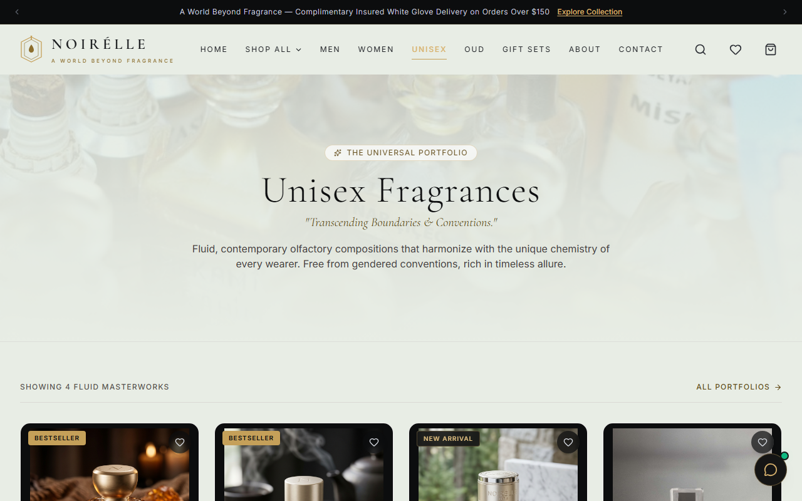 |

| 05 • Oud & Oriental Sanctuary | 06 • Artisan Gift Coffrets |
| :---: | :---: |
| 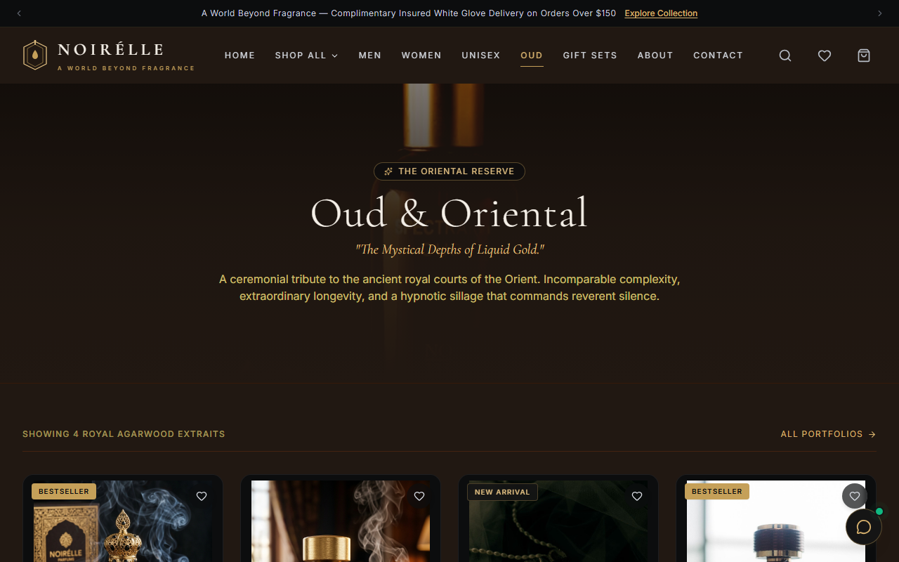 | 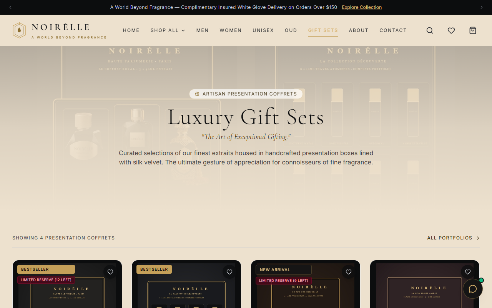 |

| 07 • Product Details & Notes | 08 • Persistent Cart Drawer & Page |
| :---: | :---: |
| 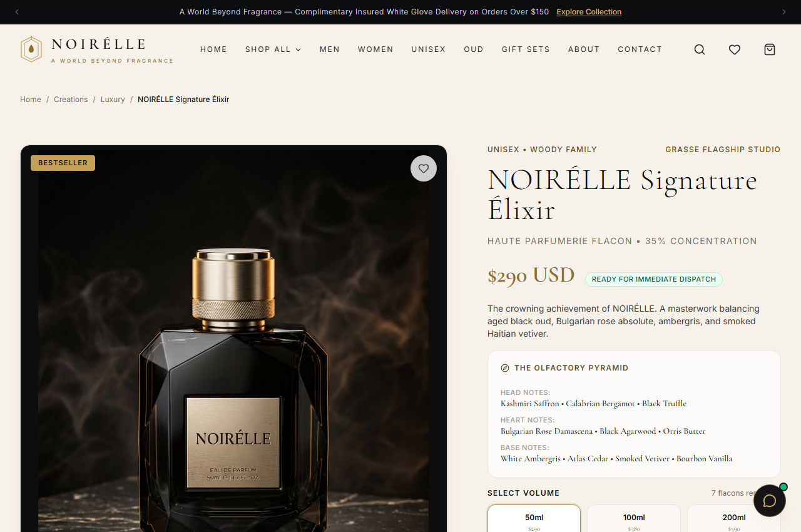 | 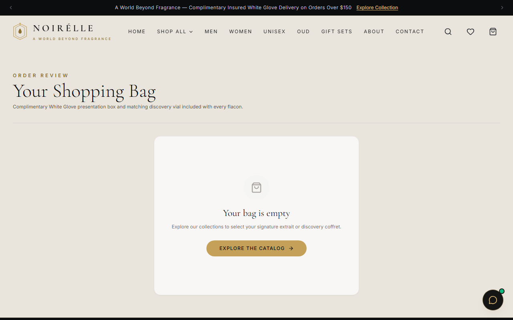 |

| 09 • Curated Wishlist | 10 • Concierge Checkout |
| :---: | :---: |
| 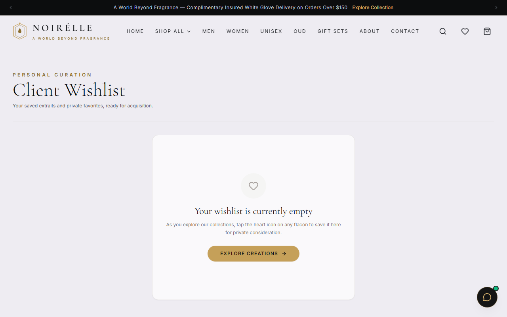 | 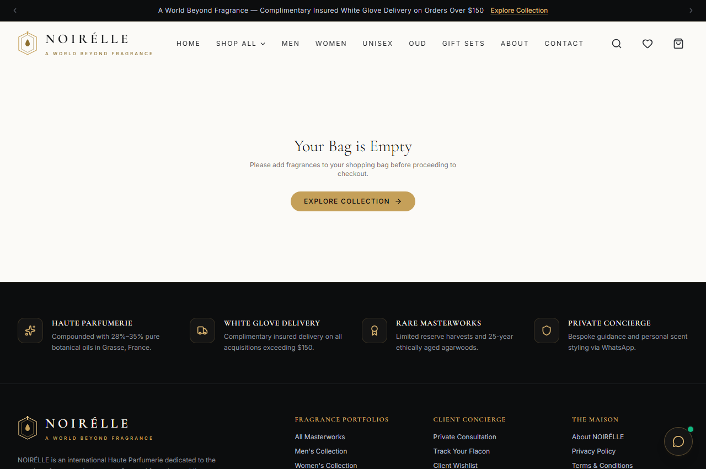 |

### Mobile Responsive Flagship

<p align="center">
  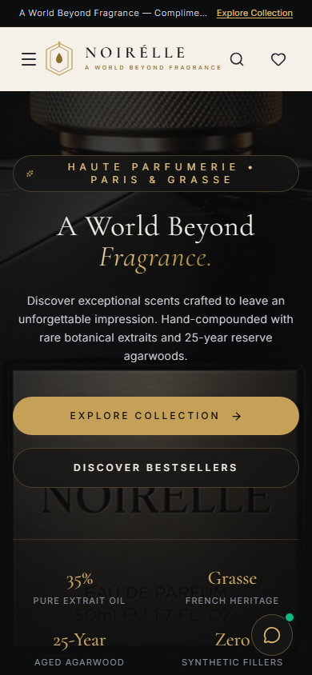
</p>

</div>

---

## ✦ System Architecture

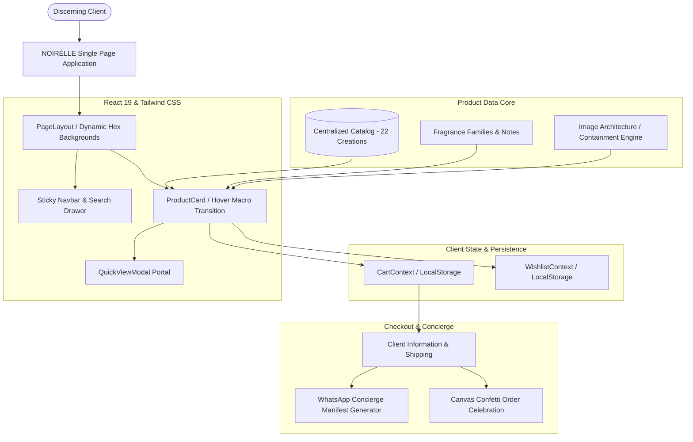

---

## ✦ Features Showcase

### 1. The Five Realms of NOIRÉLLE
- **Men's Fragrances:** Bold smoky vetiver root, charred French oak, Cuban tobacco, and aged sandalwood.
- **Women's Fragrances:** Hand-harvested Grasse May Rose Centifolia, golden Indian tuberose, and soft white gardenia.
- **Unisex Fragrances:** Luminous Baltic amber, Ceylon black tea leaves, and mineral Mediterranean cypress.
- **Oud & Oriental:** Sovereign 25-year aged Cambodian agarwood, Taif rose petals, and golden ambergris.
- **Luxury Gift Coffrets:** Hand-lacquered black piano-wood chests, espresso velvet duos, and saffiano travel sets.

### 2. Flacon Imagery Standards
- **Bespoke Flacon Visuals:** Custom-designed high-resolution crystal flacons featuring engraved NOIRÉLLE branding on natural pedestals.
- **Dual-Perspective Interaction:** Every product card switches smoothly on hover to an intimate macro craftsmanship angle showing the champagne-gold collar, atomizer, and glass cuts.
- **Strict Aspect Ratios:** All product cards enforce `object-contain p-2` to prevent cropping of atomizers and gold caps.

### 3. Shopping Experience & Concierge Checkout
- **Persistent State:** Cart and wishlist states survive browser refreshes via encrypted LocalStorage caching.
- **Interactive Sizing:** Real-time volume selection (50ml, 100ml, 200ml) with dynamic price calculation.
- **Concierge WhatsApp Integration:** Generates formatted order manifests ready for direct communication with boutique concierges.
- **Client-Side Search & Multi-Filters:** Instantaneous filtering across fragrance families, genders, price tiers, and concentrations.

---

## ✦ Technology Stack

| Domain | Technology | Version | Purpose |
| :--- | :--- | :--- | :--- |
| **Framework** | React | `^19.3.1` | Concurrent component rendering & hooks |
| **Language** | TypeScript | `~7.0.2` | Complete type-safe catalog, cart, and route contracts |
| **Build Tool** | Vite | `^8.3.6` | Sub-second HMR and production rollups |
| **Styling** | Tailwind CSS | `^3.4.19` | Design token system with custom gold & noir palettes |
| **Routing** | React Router | `^7.18.6` | Declarative SPA navigation and dynamic `/product/:slug` routes |
| **Icons** | Lucide React | `^1.77.0` | Minimalist luxury UI icon set |
| **Effects** | Canvas Confetti | `^1.9.4` | Post-order celebration particles |
| **Code Quality** | Oxlint | `^1.90.0` | High-speed static analysis & linting |

---

## ✦ Project Directory Tree

```
Luxury-Perfumes/
│
├── public/
│   ├── images/
│   │   ├── banners/          # Seasonal & collection banners
│   │   ├── campaigns/        # Flagship editorial campaign assets
│   │   ├── categories/       # Fragrance family visual cards
│   │   ├── collections/      # Realm hero images (men, women, unisex, oud, etc.)
│   │   ├── hero/             # Cinematic landing hero images
│   │   ├── logo/             # NOIRÉLLE vector emblems & wordmarks
│   │   ├── products/         # 22 luxury perfume flacons & macro views
│   │   │   └── gift-sets/    # Master presentation coffrets & discovery sets
│   │   └── social/           # High-resolution social graph assets
│   ├── favicon.svg
│   ├── robots.txt
│   └── sitemap.xml
│
├── src/
│   ├── components/
│   │   ├── cart/             # Slide-over CartDrawer component
│   │   ├── common/           # QuickViewModal, LuxuryLoader
│   │   ├── home/             # HeroBanner, FeaturedCollections, BrandStory, etc.
│   │   ├── layout/           # Sticky Navbar, Footer, Dynamic PageLayout
│   │   └── products/         # ProductCard with dual-image hover transition
│   ├── context/
│   │   ├── CartContext.tsx   # Global cart state, totals, and WhatsApp manifest
│   │   └── WishlistContext.tsx # Global wishlist state & sync
│   ├── data/
│   │   ├── collections.ts    # Realm descriptions, background colors & accents
│   │   ├── products.ts       # Centralized 22 master perfume creations catalog
│   │   └── testimonials.ts   # Demonstration client feedback
│   ├── pages/
│   │   ├── About/            # Brand philosophy & craftsmanship atelier
│   │   ├── Admin/            # Inventory & catalog management showcase
│   │   ├── Cart/             # Full responsive shopping cart view
│   │   ├── Checkout/         # Multi-step luxury checkout form
│   │   ├── Collections/      # Individual realm collection pages
│   │   ├── Contact/          # Concierge messaging & private appointment booking
│   │   ├── Home/             # Flagship storefront view
│   │   ├── NotFound/         # Custom 404 luxury error page
│   │   ├── OrderSuccess/     # Confetti-celebrated order confirmation
│   │   ├── OrderTracking/    # Real-time order status tracking simulation
│   │   ├── Policies/         # Shipping, Returns, Privacy, Terms legal policies
│   │   ├── ProductDetails/   # Dynamic flacon detail pages (/product/:slug)
│   │   ├── Search/           # Real-time search query resolver
│   │   ├── Shop/             # Complete catalog with multi-facet filters
│   │   └── Wishlist/         # Saved private wardrobe
│   ├── types/
│   │   ├── collection.ts     # Collection metadata interfaces
│   │   └── product.ts        # Typed fragrance, flacon size, and review contracts
│   ├── utils/
│   │   └── whatsapp.ts       # Concierge message formatter
│   ├── App.tsx               # Route manifest definition
│   ├── index.css             # Tailwind layers, luxury fonts & custom utilities
│   └── main.tsx              # React DOM entry point
│
├── docs/
│   ├── images/               # High-resolution GitHub README banner
│   ├── screenshots/          # 12 real runtime captures (desktop & mobile)
│   ├── ARCHITECTURE.md       # Deep-dive system architecture specification
│   ├── DEPLOYMENT.md         # Vercel, Netlify, and Cloudflare Pages setup
│   ├── IMAGE_ASSETS.md       # Media guidelines & aspect ratio standards
│   ├── INSTALLATION.md       # Local developer onboarding guide
│   ├── PROJECT_OVERVIEW.md   # Product scope & design philosophy
│   └── TESTING.md            # Static testing & verification scripts
│
├── .env.example              # Safe environment variable configuration template
├── .gitignore                # Production security & build output ignore rules
├── index.html                # HTML5 entry with luxury typography pre-connects
├── package.json              # Project dependencies and script runner
├── postcss.config.js         # PostCSS configuration
├── tailwind.config.js        # Custom champagne gold, ivory & noir color extensions
├── tsconfig.json             # Root TypeScript compilation configuration
└── vite.config.ts            # Vite optimization and plugin configuration
```

---

## ✦ Getting Started

### Prerequisites
- Node.js (version `18.0.0` or higher)
- npm, yarn, or pnpm

### Quick Installation

```bash
# 1. Clone the repository
git clone https://github.com/danishalipny-pixel/Luxury-Perfumes.git

# 2. Enter project directory
cd Luxury-Perfumes

# 3. Install dependencies
npm install

# 4. Copy environment configuration template
cp .env.example .env

# 5. Start development server
npm run dev
```

Open `http://localhost:5173` (or `http://localhost:5174`) in your browser to explore the website.

### Production Build & Linting

```bash
# Compile optimized production bundle
npm run build

# Run fast static code analysis
npm run lint

# Preview production build locally
npm run preview
```

---

## ✦ Project Documentation

For in-depth documentation, please explore the dedicated files in the `docs/` directory:

- [Project Overview](docs/PROJECT_OVERVIEW.md) — Scope, design direction, and brand philosophy
- [System Architecture](docs/ARCHITECTURE.md) — Component graph, data flows, and state management
- [Image Asset Architecture](docs/IMAGE_ASSETS.md) — Flacon resolution standards and aspect ratios
- [Installation Guide](docs/INSTALLATION.md) — Step-by-step developer setup
- [Deployment Guide](docs/DEPLOYMENT.md) — Vercel, Netlify, and static CDN hosting
- [Testing & Quality Assurance](docs/TESTING.md) — Build verification and route integrity audits

---

<div align="center">

### NOIRÉLLE
*A World Beyond Fragrance.*

Designed and developed by **Danish Rashid**.

**GitHub:** [@danishalipny-pixel](https://github.com/danishalipny-pixel) • **Repository:** [Luxury-Perfumes](https://github.com/danishalipny-pixel/Luxury-Perfumes)

</div>
